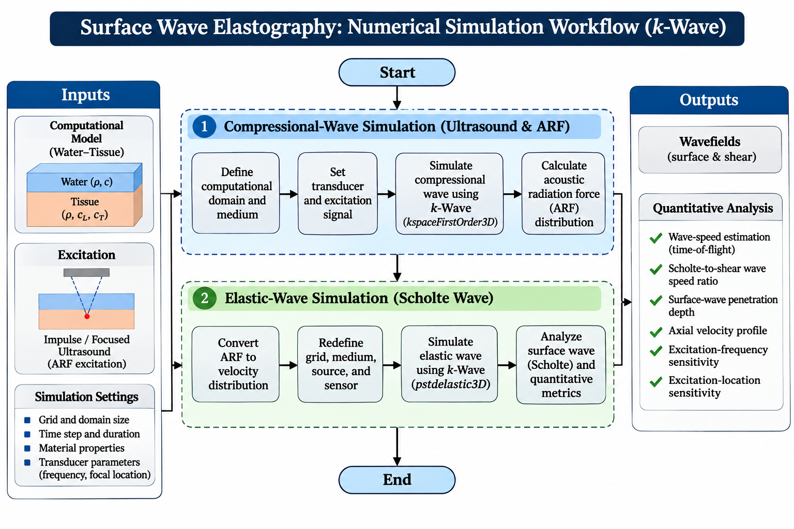
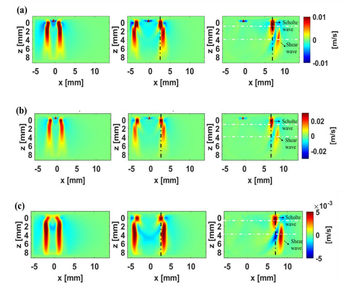

# Numerical Simulation of Surface Acoustic Wave Elastography Using k-Wave

## Overview

This project developed a **numerical simulation framework for impulse-induced surface acoustic wave elastography** using the **k-Wave acoustic simulation toolbox**.

The work investigated the generation and propagation of **Scholte waves at liquid–tissue interfaces** and **Rayleigh waves at air–tissue interfaces**, with the goal of improving quantitative characterization of superficial tissue elasticity.

The framework combined **compressional-wave simulation, acoustic radiation force (ARF) modeling, elastic-wave simulation, surface-wave tracking, wave-speed estimation, penetration-depth analysis, and excitation-parameter optimization**.

## Methods

- Developed **two-phase numerical models** representing water–tissue and air–tissue interfaces.
- Simulated ultrasound pressure fields using the **k-Wave pseudospectral acoustic simulation framework**.
- Calculated **acoustic radiation force (ARF)** distributions for impulsive surface-wave excitation.
- Evaluated three ARF approximation approaches: **second-order, quasi-plane-wave, and attenuated plane-wave methods**.
- Simulated the resulting **Scholte, Rayleigh, and shear-wave propagation** in elastic tissue.
- Estimated surface and shear-wave velocities using **time-of-flight analysis**.
- Quantified **surface-wave penetration depth, wave profile, and spatial propagation characteristics**.
- Investigated the effects of **excitation frequency (3 vs. 6 MHz)** and **focal position** at, above, and below the tissue interface.

### Simulation Workflow

*Numerical workflow from tissue/interface definition and ultrasound pressure-field simulation through ARF estimation, elastic-wave propagation, and quantitative surface-wave analysis.*

## Key Findings

- ARF excitation successfully generated **Scholte waves along the water–tissue interface together with shear waves propagating within the tissue**.
- Scholte-wave velocities were approximately **43 m/s**, compared with shear-wave velocities of approximately **52 m/s** in the primary simulation model.
- The resulting **Scholte-to-shear wave-speed ratio was approximately 0.83**, closely matching the theoretical value of approximately **0.839**.
- Excitation frequency strongly affected the acoustic focal region: **3 MHz produced a broader focal zone**, whereas **6 MHz produced a narrower, more localized excitation region**.
- Excitation position significantly affected **energy distribution and surface-wave penetration depth**.
- Surface, above-surface, and below-surface excitation produced penetration depths of approximately **2.04, 2.27, and 2.15 mm**, respectively.
- Rayleigh-wave simulations demonstrated separation of the surface wave from the bulk shear wave during propagation.
- Simulated Rayleigh and shear-wave velocities were approximately **46.20 and 50.16 m/s**, respectively, producing a Rayleigh-to-shear speed ratio of **0.921**, consistent with theoretical expectations.
- Rayleigh-wave penetration depth remained approximately **1.27 mm**, supporting its application to superficial tissue characterization.

## Surface Wave Propagation

### Scholte Wave Generation

*Time-resolved propagation of impulse-induced Scholte and shear waves following ARF excitation at the water–tissue interface.*

The Scholte wave remains concentrated near the **liquid–tissue interface**, while the simultaneously generated shear wave propagates through the deeper tissue region.

## Excitation Parameter Analysis

The simulations demonstrated that **excitation frequency and focal position control the spatial distribution of acoustic energy, beam width, wave amplitude, and penetration depth**, providing a computational framework for optimizing surface-wave elastography.

## Quantitative Analysis

Wave propagation was analyzed using:

- **Time-of-flight wave-speed estimation**
- **Scholte-to-shear wave-speed ratio**
- **Rayleigh-to-shear wave-speed ratio**
- **Axial velocity profiles**
- **Surface-wave penetration depth**
- **Acoustic pressure-field distribution**
- **ARF spatial distribution**
- **Excitation-frequency sensitivity**
- **Excitation-location sensitivity**

These quantitative measurements were compared with analytical surface-wave theory to evaluate the accuracy and reliability of the numerical framework.

## Technical Skills

**MATLAB • k-Wave • Ultrasound Simulation • Biomedical Acoustics • Acoustic Radiation Force • Elastography • Scholte Waves • Rayleigh Waves • Shear Waves • Wave Propagation • Signal Processing • Time-of-Flight Analysis • Numerical Modeling • Pseudospectral Methods • Quantitative Imaging**

## Dissertation

**Al Masud A.** *Numerical Simulation of Impulse-Induced Surface Acoustic Wave Elastography Using k-Wave Acoustic Simulation Toolbox.* **PhD Dissertation, Mechanical Engineering, Texas Tech University, 2024.**

## Research Applications

- Superficial tissue elastography
- Quantitative tissue stiffness assessment
- Ultrasound surface-wave imaging
- Optimization of ARF excitation parameters
- Computational validation of elastography methods
- Development of Rayleigh- and Scholte-wave-based imaging techniques

## Collaboration

- Department of Mechanical Engineering, Texas Tech University
- Biomedical Engineering research collaboration, Texas Tech University

## Resources

- 📄 PhD Dissertation
- 💻 GitHub Repository: Coming Soon
- 💻 MATLAB / k-Wave Simulation Code: Coming Soon
